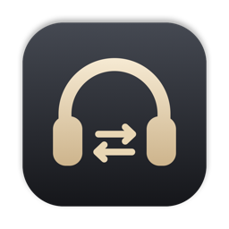

<div align="center">



# Toss

**Перекидывайте Bluetooth-наушники между Mac и телефоном одним кликом.**

Маленькое приложение для строки меню macOS. Без окон, без Дока, без настроек на десять экранов.


</div>

---

## Зачем

Наушники подключены к телефону, а вы сели за Mac. Обычно это значит открыть настройки Bluetooth, найти наушники и нажать «Подключить». Потом то же самое в обратную сторону.

С Toss это один клик по иконке в строке меню.

## Как пользоваться

| Действие | Что произойдёт |
|---|---|
| **Левый клик** по иконке | Наушники переходят на Mac, если были на телефоне, и наоборот |
| **Правый клик** | Меню: переключить, выбрать наушники, запуск при входе, выход |
| Наведение курсора | Подсказка: какие наушники и где они сейчас |

При первом запуске выберите наушники: правый клик → **Наушники** → ваша модель. Выбор сохраняется.

## Что показывает иконка

<table>
  <tr>
    <td align="center" width="25%">
      <picture>
        <source media="(prefers-color-scheme: dark)" srcset="docs/states/mac-dark.png">
        
      </picture><br>
      <b>На Mac</b><br>
      <sub>Клик отдаст наушники телефону</sub>
    </td>
    <td align="center" width="25%">
      <picture>
        <source media="(prefers-color-scheme: dark)" srcset="docs/states/phone-dark.png">
        
      </picture><br>
      <b>На телефоне</b><br>
      <sub>Клик заберёт наушники на Mac</sub>
    </td>
    <td align="center" width="25%">
      <picture>
        <source media="(prefers-color-scheme: dark)" srcset="docs/states/loading-dark.png">
        
      </picture><br>
      <b>Переключаю…</b><br>
      <sub>Пульсирует, пока наушники переходят</sub>
    </td>
    <td align="center" width="25%">
      <picture>
        <source media="(prefers-color-scheme: dark)" srcset="docs/states/none-dark.png">
        
      </picture><br>
      <b>Нет наушников</b><br>
      <sub>Не выбраны или больше не сопряжены</sub>
    </td>
  </tr>
</table>

Иконки плавно перетекают друг в друга. Между ноутбуком и перечёркнутым ноутбуком работает Magic Replace (macOS 15+): черта прорисовывается прямо на иконке.

## Установка

Нужны Command Line Tools:

```sh
xcode-select --install
```

Соберите и запустите:

```sh
git clone git@github.com:iufb/toss.git
cd toss
./build.sh
open Toss.app
```

Чтобы Toss запускался сам, включите в его меню **Запускать при входе**. Приложение можно перенести в `/Applications`. Если после переноса автозапуск перестанет работать, выключите и снова включите этот пункт.

При первом подключении macOS спросит доступ к Bluetooth. Разрешите, без него Toss не видит наушники.

## Как это работает

- Toss следит за выбранными наушниками через `IOBluetooth` и раз в 2 секунды сверяет, подключены ли они к Mac. Поэтому иконка обновится, даже если вы переключили наушники вручную или выключили их.
- **Забрать на Mac**: Toss открывает Bluetooth-соединение с наушниками.
- **Отдать телефону**: Toss разрывает соединение с Mac. Наушники сами возвращаются к телефону, если он рядом и с ними сопряжён.
- Пока идёт переключение, иконка пульсирует. Toss ждёт, когда соединение действительно сменится, но не дольше 15 секунд.

> [!NOTE]
> Toss управляет только связью наушников с Mac. Подключиться к телефону наушники должны сами. Обычно это происходит автоматически, но зависит от модели наушников и телефона.

## Требования

| | |
|---|---|
| Система | macOS 13 Ventura и новее |
| Анимации иконок | macOS 14+ (пульс и смена), Magic Replace на macOS 15+ |
| Наушники | Любые Bluetooth-наушники, сопряжённые с Mac |

На macOS 13 всё работает, только иконки меняются без анимации.

## Структура

```
toss/
├── main.swift        приложение целиком
├── build.sh          собирает Toss.app и подписывает его локально
├── make_icon.swift   рисует иконку приложения и собирает AppIcon.icns
├── AppIcon.icns      готовая иконка (её берёт build.sh)
└── docs/             картинки для этого README
```

### Иконка приложения

Иконка «Графит» нарисована кодом на Core Graphics, без графических редакторов. Чтобы её поменять, отредактируйте `make_icon.swift` и пересоберите:

```sh
swift make_icon.swift .
iconutil -c icns AppIcon.iconset -o AppIcon.icns && rm -rf AppIcon.iconset
./build.sh
```
